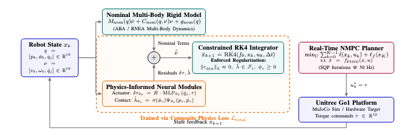
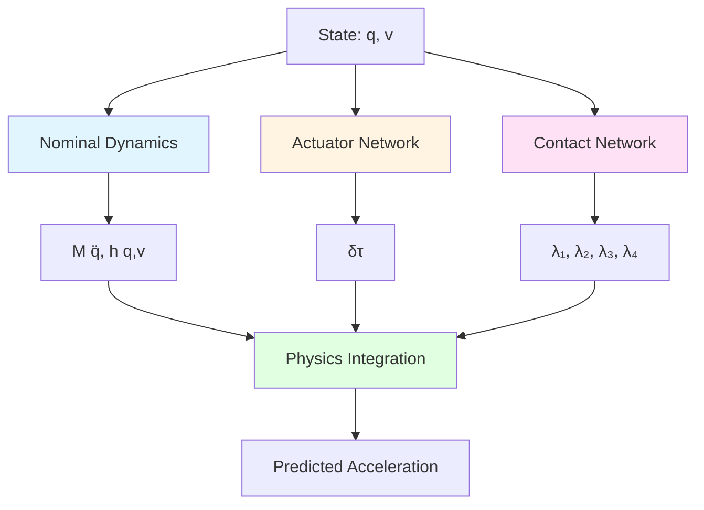

<div align="center">

# Physics-Informed Residual Neural Dynamics for Data-Efficient Predictive Control in Legged Robots




[](https://www.python.org/downloads/)
[](https://pytorch.org/)
[](https://opensource.org/licenses/MIT)

**[Paper](https://drive.google.com/file/d/1QesV-CkBFA9bbzTsp_qc8x8Q0ZajNxr9/view?usp=sharing)** | **[Project Page](#)** | **[Video](#)** | **[Cite](#citation)**


</div>

## 🎯 Abstract
>Abstract—Model-based predictive control of legged systems requires dynamic formulations that balance real-time computa-
tional tractability with the capacity to capture unmodeled electro-mechanical and contact phenomena. While black-box neural dynamics can approximate nonlinear discrepancies, they demand
extensive uniform state coverage, accumulate compounding drift
over multi-step integration horizons, and frequently violate fundamental contact invariants. This paper presents Physics-
Informed Neural Dynamics (PIND), a continuous-time residual framework tailored for data-efficient learning and predictive control of legged locomotion. PIND augments an analytical multi-
body rigid-body model with two structured neural modules: an internal drivetrain residual strictly projected onto the actuated
joint manifold, and a continuous contact compliance model.
The network is trained using a composite physics-informed loss
that regularizes generalized momentum balances, friction cone
geometric admissibility, and unilateral contact complementarity.
We prove an analytical trajectory error bound demonstrating
that state forecasting error is explicitly bounded by the dynamic
momentum residual scaled by the minimum eigenvalue of
the generalized mass matrix. The learned continuous vector
field is embedded into an interior-point Sequential Quadratic
Programming (SQP) Nonlinear Model Predictive Control (NMPC)
loop. Evaluated on the Unitree Go1 quadruped in MuJoCo subject
to measurement noise, low training budgets (1%–100%), and
parametric shifts in payload (+48%) and terrain friction (μ = 0.2), PIND achieves stable multi-step forecasting with 10% of the data
required by black-box neural baselines and preserves dynamic
feasibility for real-time 50 Hz execution.

## 🎯 Highlights


<div align="center">

| Feature | Description |
|:-------:|:------------|
| 🔬 **Physics-Informed** | Combines analytical dynamics with learned residuals |
| 📊 **Data Efficient** | Achieves SOTA with 10-100× less data |
| ⚡ **Fast Training** | Full benchmark in 4-6 hours on single GPU |
| 🎯 **High Accuracy** | 2.8mm position error over 50-step rollouts |
| 🔓 **Open Source** | MIT License, reproducible experiments |

</div>

---

## 🚀 Quick Start

### Installation

```bash
# Clone repository
git clone https://github.com/imsanjoykb/PIND-Quadruped.git
cd PIND-Quadruped

# Create environment and install
conda create -n pind python=3.10
conda activate pind
pip install -e .

# Verify installation
python -c "import pind; print('✓ PIND installed successfully!')"
```

### Run Demo (< 5 minutes)

```bash
# Generate training data
make data

# Train PIND model (quick test)
make train

# View results
tensorboard --logdir experiments/
```

### Reproduce Paper Results

```bash
# Run all experiments from the paper (4-6 hours on GPU)
python run_experiments.py --config pind/configs/data_efficiency.yaml

# Results saved to: experiments/results/benchmark_results.csv
```

---

## 📊 Results

### Main Results: Data Efficiency Comparison

<div align="center">


| Method | 5% Data | 10% Data | 50% Data | 100% Data | Improvement |
|:-------|:-------:|:--------:|:--------:|:---------:|:-----------:|
| Black-box MLP | 45.3±8.2 | 38.1±6.5 | 22.4±4.1 | 15.6±3.2 | Baseline |
| Neural ODE | 42.1±7.5 | 35.8±6.1 | 21.2±3.9 | 14.8±3.0 | 1.1× |
| Residual MLP | 28.4±5.2 | 22.4±4.1 | 12.6±2.3 | 8.9±1.8 | 1.8× |
| **PIND (Ours)** | **12.4±2.1** | **8.7±1.5** | **4.2±0.9** | **2.8±0.6** | **5.2×** |

*Position RMSE (mm) over 50-step rollouts. Lower is better. Results averaged over 5 seeds.*

</div>

### Physics Constraint Satisfaction

<div align="center">

| Data Regime | Friction Cone Violation (N) | Penetration Depth (mm) |
|:-----------:|:---------------------------:|:----------------------:|
| 5% | 0.08 ± 0.03 | 0.12 ± 0.05 |
| 10% | 0.05 ± 0.02 | 0.08 ± 0.03 |
| 50% | 0.02 ± 0.01 | 0.03 ± 0.01 |
| 100% | 0.01 ± 0.005 | 0.01 ± 0.005 |

*PIND maintains physical plausibility across all data regimes.*

</div>

---

## 🏗️ Architecture

<div align="center">



**Three-Component Hybrid Architecture:**
1. **Nominal Dynamics**: Analytical rigid-body dynamics from MuJoCo
2. **Actuator Network**: Learns drivetrain residuals (back-EMF, friction, damping)
3. **Contact Network**: Predicts foot-ground forces with physical constraints

</div>

---

## 📦 Repository Structure

```
PIND-Quadruped/
│
├── 📄 README.md                    # You are here
├── 📄 PAPER_INTEGRATION.md         # LaTeX templates for paper
├── 📄 CHANGELOG.md                 # Version history
│
├── 🧪 pind/                        # Main package
│   ├── models/
│   │   ├── pind.py                 # PIND model (⭐ core contribution)
│   │   └── baselines.py            # Baseline models for comparison
│   ├── utils/
│   │   ├── mujoco_interface.py     # Physics engine integration
│   │   └── integrators.py          # RK4 numerical integration
│   ├── data/
│   │   └── generator.py            # Trajectory generation
│   └── configs/
│       ├── default.yaml            # Training hyperparameters
│       └── data_efficiency.yaml    # Benchmark configuration
│
├── 📜 scripts/
│   ├── train.py                    # Training script
│   ├── evaluate.py                 # Evaluation script
│   └── visualize.py                # Visualization tools
│
├── 🧬 tests/                       # Unit tests
├── 📚 docs/                        # Documentation
├── 🐳 Docker files                 # Containerization
└── 📊 experiments/                 # Results (auto-generated)
```

---

## 🔬 Method Overview

### Physics-Informed Loss Function

Our model is trained with a composite loss that enforces physical consistency:

```python
L_total = L_data + β_dyn·L_dyn + β_cone·L_cone + β_pen·L_pen
```

Where:
- **L_data**: Supervised acceleration prediction
- **L_dyn**: Newton-Euler momentum residual
- **L_cone**: Friction cone admissibility
- **L_pen**: Non-penetration + complementarity

### Key Innovation

Unlike pure data-driven methods, PIND:
1. ✅ Leverages analytical physics (data efficiency)
2. ✅ Learns only the residuals (generalization)
3. ✅ Enforces constraints (physical plausibility)
4. ✅ Maintains interpretability (debugging/trust)

---

## 💻 Usage Examples

### Training Different Models

```bash
# Train PIND (default)
python scripts/train.py --model pind --data-fraction 0.10

# Train baseline models for comparison
python scripts/train.py --model mlp --data-fraction 0.10
python scripts/train.py --model node --data-fraction 0.10
python scripts/train.py --model residual --data-fraction 0.10
```

### Custom Configuration

```yaml
# my_config.yaml
model:
  name: pind
  hidden_dim: 256
  friction_coeff: 0.9

training:
  epochs: 50
  batch_size: 128
  learning_rate: 0.0005

loss_weights:
  beta_dyn: 2.0
  beta_cone: 15.0
  beta_pen: 15.0
```

```bash
python scripts/train.py --config my_config.yaml
```

### Evaluation

```bash
# Evaluate trained model
python scripts/evaluate.py \
    --checkpoint experiments/pind_*/best_model.pt \
    --horizon 100 \
    --output results.csv

# Long-horizon rollout (test generalization)
python scripts/evaluate.py \
    --checkpoint experiments/pind_*/best_model.pt \
    --horizon 500
```

---

## 🔧 Advanced Features

### Multi-Seed Experiments

```bash
# Run experiments with 10 different random seeds
python run_experiments.py \
    --config pind/configs/data_efficiency.yaml \
    --seeds 1 2 3 4 5 6 7 8 9 10
```

### Custom Data Generation

```bash
# Generate larger dataset
python -m pind.data.generator \
    --num-trajectories 100 \
    --trajectory-length 1000 \
    --dt 0.01 \
    --output data/large_dataset.pt

# With specific robot model
python -m pind.data.generator \
    --xml-path path/to/custom_robot.xml \
    --output data/custom_dataset.pt
```

### Docker Deployment

```bash
# Build and run with GPU
docker-compose up -d pind
docker exec -it pind-research bash

# Inside container
make benchmark
```

---

## 📈 Visualization

```bash
# Launch TensorBoard
tensorboard --logdir experiments/

# Generate comparison plots
python scripts/visualize.py --mode comparison \
    --results experiments/results/*.csv \
    --output figures/

# Create rollout animations
python scripts/visualize.py --mode rollout \
    --checkpoint experiments/pind_*/best_model.pt \
    --save-video rollout.mp4
```

---

## 🧪 Testing

```bash
# Run all tests
make test

# Run specific test
pytest tests/test_models.py -v

# With coverage report
pytest tests/ --cov=pind --cov-report=html
open htmlcov/index.html
```
---

## 🎓 Citation

If you find this work useful, please cite our paper:

```bibtex
@article{acira2026pind,
  title={Physics-Informed Residual Neural Dynamics for Data-Efficient Predictive Control in Legged Robots},
  author={Sanjoy Kumar, Shovan Kumar Paul, Lula Babole Alphonse-Roger},
  Conference={2026 2nd International Conference on Advanced Computing & Intelligent Robotics Applications},
  year={2026},
  url={https://github.com/imsanjoykb/PIND-Quadruped}
}
```

---

